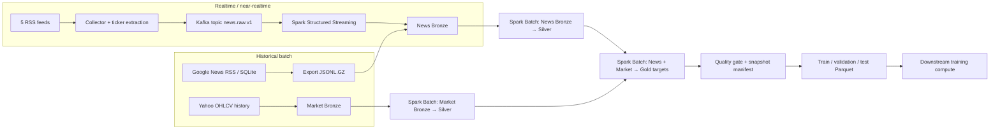

# Big Data Pipeline Design: từ News/Market đến Training Dataset

**Cập nhật:** 28/10/2026
**Trọng tâm:** data engineering và Big Data workflow sau khi thu thập news/market. Tài liệu mô tả Kafka, Spark, Bronze/Silver/Gold, partition, tính toán theo phiên, quality gates và cách bàn giao snapshot cho bước train. Kiến trúc model và kết quả ML không phải trọng tâm ở đây.

## 1. Mục tiêu và ranh giới hệ thống

Mục tiêu là tạo một pipeline có thể nhận dữ liệu lịch sử theo batch và dữ liệu mới qua Kafka, chuẩn hóa hai luồng vào cùng data contract, sau đó dùng Spark để tạo các bảng sạch, có thể kiểm tra và truy xuất lại.

Đơn vị dữ liệu đầu ra cho downstream training là một cặp **`(event_id, ticker)`**. Một bài nhắc nhiều mã VN30 tạo một dòng cho mỗi mã. Spark chịu trách nhiệm chuẩn bị data và target; bước train nhận các snapshot Parquet đã có schema, label, mask và split rõ ràng.



**Big Data boundary:** Kafka nhận và lưu luồng event; Spark xử lý các partition của Bronze/Silver/Gold; Gold snapshot là ranh giới giữa data engineering và model training. Trong workflow hiện tại, Spark chạy local trên một máy; đây là Spark batch và local parallelism, chưa phải cluster nhiều node.

## 2. Trạng thái triển khai cần phân biệt

| Thành phần | Trạng thái trong code/dữ liệu hiện tại |
|---|---|
| Historical news | Google News RSS theo ticker/tháng; lưu SQLite; export sang Bronze JSONL.GZ có code. Backfill có giới hạn và không phải archive đầy đủ. |
| Realtime ingestion | Có 5 RSS feeds, Kafka producer và Spark Kafka-to-Bronze consumer. Chỉ hoạt động liên tục khi người vận hành bật service/job; lượt tạo training snapshot historical không đọc Kafka trực tiếp. |
| News Silver | Có Spark job chuẩn hóa, dedup, ticker extraction, quality flags, Parquet theo tháng. |
| Market Silver | Có Spark job validate OHLCV, tính daily returns, flag price jump. Market Silver hiện có được tái sử dụng trong historical sync. |
| Gold event window | Có Spark job tính relative-session stock/benchmark/abnormal return. Đây là bảng event-study, khác với raw-return training targets. |
| Gold training targets | Có Spark job tạo `(event_id,ticker)` cùng target/mask và market context point-in-time. |
| Phân tán nhiều máy | Chưa cấu hình Spark Standalone/YARN/Kubernetes hoặc executor trên nhiều node. |
| ADLS | ADLS backend dùng được cho một số Bronze writes; `sync_historical_lake.py` hiện dùng `LocalLakeStorage` và ghi pipeline đầy đủ ở local. Tự động publish Silver/Gold lên ADLS chưa được thực hiện bởi script đó. |
| Training split | Temporal split hiện tạo trong Python/Pandas. Chưa phải Spark split. |

Các trạng thái trên giúp tách **đã có trong repo** khỏi **kiến trúc đích**. Không nên trình bày local Spark như cluster hoặc nói dữ liệu đã tự động lên ADLS nếu chưa chạy bước upload tương ứng.

## 3. Medallion data flow

### 3.1 Ingestion → Bronze: giữ raw và truy vết nguồn

Bronze là lớp lưu raw event trước khi áp dụng các quy tắc phân tích. Đây là nơi có thể kiểm tra lại payload nếu Silver/Gold cần được rebuild.

**News record** thường mang các nhóm trường:

- Identity/schema: `event_id`, `schema_version`, `event_type`.
- Nguồn: `source`, `url`, `resolved_url`, `author`, `image_url`.
- Văn bản: `title`, `summary`, `content`.
- Ticker provenance: `rulebased_tickers`, `ner_tickers`, `merged_tickers`, `ticker_extraction_strategy`.
- Thời gian: `published_at_raw`, UTC/Vietnam time, `published_precision`, `collected_at_utc`, `ingest_date`.
- Crawl state: enrichment/extraction status, attempts và error nếu có.
- Streaming lineage: Kafka `topic`, `partition`, `offset`, timestamp khi được phát từ Kafka.

**Market record** có `ticker`, `session_date`, interval, OHLCV, currency, adjustment type, source và ingestion metadata.

Bronze files ở dạng JSONL/GZ. Với stream, layout hướng tới `ingest_date=YYYY-MM-DD/hour=HH`; với historical export, file được chia shard theo dải SQLite IDs. Event ID giúp chống duplicate ở các bước sau; Kafka offset giúp truy vết record đã tiêu thụ.

```text
bronze/
├── news_stream/ingest_date=YYYY-MM-DD/hour=HH/*.jsonl.gz
└── market/ingest_date=YYYY-MM-DD/*.jsonl.gz
```

Bronze nên giữ raw; không xóa event chỉ vì bài thiếu full text. Lọc theo chất lượng là quy tắc downstream của Silver/Gold, giữ lại metadata/status để audit.

### 3.2 Spark News Bronze → Silver

Job: `news_system/spark_jobs/bronze_to_silver.py`.

Spark đọc JSON theo schema cố định, sau đó thực hiện trên DataFrame:

1. Chuẩn hóa HTML, whitespace, source, URL và timestamp.
2. Tính `content_length`, `has_full_text` (content từ 200 ký tự trở lên).
3. Dùng window `row_number()` partition theo `event_id`, xếp hạng bản có full text trước, content dài hơn trước, rồi bản thu thập mới hơn; giữ một bản tốt nhất.
4. Tạo text cho ticker extraction từ title cộng content nếu đủ dài, nếu không dùng summary.
5. Tạo `content_hash`; trích mã VN30 bằng rule-based, và thêm CRF NER nếu cung cấp model.
6. Tạo `merged_tickers`, quality errors và `is_valid`.
7. Ghi Parquet partition theo `published_year_month`.

Output đang dùng: `data_lake/silver/news_v2/`.

Mỗi record Silver có normalized text, publication metadata, content hash, ticker lists/provenance, `has_full_text`, quality flags và tháng xuất bản. `is_valid` kiểm tra identity/title/URL/timestamp/schema; việc có ticker và có full body là các điều kiện riêng, không nên nhập nhằng với validity cơ bản.

### 3.3 Spark Market Bronze → Silver

Job: `news_system/spark_jobs/market_bronze_to_silver.py`.

Spark chuẩn hóa ticker/ngày và dedup theo `(ticker, session_date, interval, source)`, giữ bản thu thập mới nhất. Quality checks xác minh ngày, interval, giá OHLC dương và hợp lệ, high/low bao quanh OHLC, volume không âm, schema version và collection time.

Từ các phiên đã sắp theo ticker/source, Spark tạo:

```text
previous_close = lag(close, 1)
daily_return   = close / previous_close - 1
log_return     = log(close / previous_close)
```

Phiên có `abs(daily_return) > 10%` được flag `corporate_action_or_data_error` để review. Dòng có lỗi cấu trúc bị loại khỏi Silver hợp lệ; dòng price jump vẫn có thể tồn tại để audit nhưng không được dùng làm anchor/target khi cửa sổ bị flag.

Output: `data_lake/silver/market_daily_v2/`, partition theo `session_year_month`. Nguồn hiện dùng là Yahoo Finance adjusted daily OHLCV; phạm vi market trong snapshot hiện có đến 16/10/2026.

### 3.4 Hai loại Gold, hai mục đích

**Event-window Gold** (`news_system/spark_jobs/news_market_gold.py`) phục vụ EDA/event study. Nó tạo relative sessions `T-5,T-3,T-2,T-1,T0,T+1,T+2,T+3,T+5`, cumulative stock return, equal-weight VN30 benchmark return và abnormal return. Đây không phải Gold label table chính của model.

**Training-target Gold** (`news_system/spark_jobs/build_training_targets.py`) là bảng supervised-learning input/target. Nó dùng raw adjusted stock return, không dùng abnormal return làm label chính. Mỗi output row là một `(event_id,ticker)`.

## 4. Cách Spark tính point-in-time target

Job `build_training_targets.py` chạy Spark DataFrame/SQL; Spark session timezone đặt UTC và `published_timestamp` được đổi sang `Asia/Ho_Chi_Minh` để tạo event date/minute. Giờ đóng cửa quy ước trong job là 15:00.

### 4.1 Tạo feature có thể biết trước thời điểm dự báo

Spark sắp market bars theo ticker và `session_date`, tạo `session_index`, rồi tính các rolling/lag features:

- `market_return_1d`, intraday range và open gap từ anchor session.
- `market_log1p_volume` và volume ratio so với mean volume của 20 phiên trước.
- Momentum 5/20 phiên dùng close lag 5/20.
- Volatility 20 phiên là độ lệch chuẩn của daily return trong các phiên trước, không đưa phiên hiện tại vào rolling window.

Các cột này được nối với event theo ticker và anchor khả kiến. Chúng có trong Gold; việc model có sử dụng chúng hay không là lựa chọn downstream, không tự động xảy ra chỉ vì cột tồn tại.

### 4.2 Anchor và trading-session index

Anchor là close cuối cùng có thể quan sát ở prediction time:

- Tin timestamp rõ, trước 15:00 trong ngày giao dịch: anchor là close phiên trước.
- Tin timestamp rõ, từ 15:00 trở đi: anchor có thể là close cùng ngày.
- Tin ngày nghỉ/cuối tuần hoặc không có timestamp chính xác: anchor là phiên cuối trước event date.

T+1/T+3/T+5 không phải cộng ngày lịch. Spark tìm phiên đầu tiên có `session_date > event_date`; nếu đó là index `i` thì lần lượt target index là `i`, `i+2`, `i+4`. Weekend/ngày nghỉ được tự bỏ qua theo lịch phiên thực.

T0 là close cùng ngày, chỉ có khi tin có timestamp chính xác và đăng trước 15:00 vào ngày có giao dịch. Daily bar T0 so với anchor phiên trước chứa cả biến động trước thời điểm tin trong ngày, nên không đo riêng post-news reaction intraday.

### 4.3 Return, threshold label và mask

```text
raw_return_tH = target_adjusted_close_tH / anchor_adjusted_close - 1
```

Threshold hiện ở `news_system/label_contract.py`:

| Horizon | Giảm (label 0) | Neutral (label 1) | Tăng (label 2) |
|---|---:|---:|---:|
| T0 | ≤ −1,0% | giữa −1,0% và +1,0% | ≥ +1,0% |
| T+1 | ≤ −1,0% | giữa −1,0% và +1,0% | ≥ +1,0% |
| T+3 | ≤ −1,5% | giữa −1,5% và +1,5% | ≥ +1,5% |
| T+5 | ≤ −2,0% | giữa −2,0% và +2,0% | ≥ +2,0% |

Target bị mask nếu thiếu anchor/close đích, anchor có anomaly, hoặc có phiên anomaly trong đoạn từ sau anchor đến target. Không nội suy giá tương lai. Mask false được lưu cùng label `-100` và return null; downstream phải dùng mask để tính loss/metric thay vì coi missing là neutral.

Spark tính bốn horizon theo dạng long, rồi aggregate thành wide columns (`stock_return_t0`, `label_t0`, `mask_t0`, ...). Spark cũng materialize các market context feature ở cùng row.

## 5. Partitioning và distributed execution

### 5.1 Partition hiện có

| Dataset | Partition key hiện tại | Ý nghĩa |
|---|---|---|
| News Silver | `published_year_month` | Đọc/cập nhật theo tháng xuất bản. |
| Market Silver | `session_year_month` | Đọc/cập nhật theo tháng phiên giao dịch. |
| Event-window Gold | `gold_year_month` | Phân vùng event study theo tháng. |
| Training Targets v2 | `training_year` | Phân vùng theo năm event, thuận tiện tạo temporal snapshot. |
| Full-text attention snapshot | Hiện ghi một Parquet part file | Phù hợp snapshot vừa/nhỏ hiện tại; cần phân vùng/repartition nếu tăng dữ liệu lớn. |

`repartition(n)` tạo n Spark partitions/tasks để Spark xử lý song song. `--output-partitions 4` hoặc bốn part file **không** có nghĩa là có bốn máy. Hiệu quả còn phụ thuộc số input partitions, shuffle, data skew, số core và memory.

### 5.2 Demo đã chạy

Script `news_system/spark_jobs/demo_partitioned_training_data.py` đọc Gold snapshot, repartition thành 4, aggregate số row/target khả dụng theo `spark_partition_id()`, rồi ghi Parquet sang một thư mục demo riêng.

```text
Master: local[4]
Source rows: 5.068
Observed partitions: 4
Rows per partition: 1.267 / 1.267 / 1.267 / 1.267
Sum of partition rows: 5.068
Output: data_lake/demo/spark_partitioned_training_targets_20261028/
```

Đây là **local parallelism trên một máy với bốn worker threads**, không phải multi-node Spark. Input Gold chỉ đọc, không bị overwrite. Script và lệnh chạy lại nằm trong repo.

Snapshot 5.068 dòng hiện tại đủ nhỏ để xử lý bằng Pandas; demo này chứng minh partition, task và Parquet output của Spark chứ không chứng minh Spark chạy nhanh hơn Pandas. Lý do dùng Spark ở project là xây pipeline Bronze/Silver/Gold có thể partition/replay/scale lên cluster khi số feed, lịch sử và tần suất cập nhật tăng; muốn khẳng định speedup cần benchmark cùng input, cùng phép tính và cùng tài nguyên.

Lệnh tương đương khi đã activate `tf_linux`:

```bash
export SPARK_HOME="$(python -c 'import pathlib,pyspark; print(pathlib.Path(pyspark.__file__).parent)')"
export PYSPARK_PYTHON="$(which python)"
export PYSPARK_DRIVER_PYTHON="$(which python)"

spark-submit --master 'local[4]' \
  news_system/spark_jobs/demo_partitioned_training_data.py \
  --input data_lake/gold/training_targets_fulltext_attention_v1 \
  --output data_lake/demo/spark_partitioned_training_targets_v1 \
  --partitions 4
```

Conda launcher hiện không tự tìm đúng Spark home khi `SPARK_HOME` chưa đặt. Trên một Spark cluster thật cần cấu hình cluster manager (`spark://...`, YARN hoặc Kubernetes), executors/cores/memory, network và quyền đọc/ghi lake trên từng executor. Khi đó mới có distributed execution qua nhiều node.

## 6. Từ Gold đến dataset sẵn sàng cho downstream training

Đây là đoạn handoff data engineering → training. Model training tự quyết định kiến trúc/loss; phần này đảm bảo data đưa sang có thể truy vết và split đúng.

### 6.1 Filter và record contract

Input nguồn hiện tại là:

```text
data_lake/gold/training_targets_v2/
```

Gold builder chỉ giữ News Silver valid, có ticker VN30 và `content_length >= 200` cho target dataset full-text. Mỗi record downstream nên giữ tối thiểu:

- Key: `event_id`, `ticker`, `content_hash`, canonical/source URL.
- Text: `title`, `summary`, `content`, `content_length`, `has_full_text`.
- Event time: `prediction_time`, `event_date`, `published_precision`, before/after close flags.
- Pre-event market context nếu phiên bản dataset có sử dụng.
- Target: raw return và label cho từng horizon.
- Mask/anomaly: khả năng target, cờ anomaly và lý do không khả dụng.
- Provenance: schema/label contract version, data snapshot ID, source windows.

Full-text attention snapshot hiện tại:

```text
data_lake/gold/training_targets_fulltext_attention_v1/
```

Nó có **5.068 event–ticker rows**, **2.948 unique articles**, toàn bộ 30 mã VN30, ngày 01/01/2020–24/09/2026; mọi content đều ≥200 ký tự. Sau 24/09 có raw news mới trong SQLite nhưng chưa lấy được full article đạt chuẩn, nên chưa có trong snapshot train-ready này.

### 6.2 Temporal split: hiện tại và hướng Big Data

Split hiện tại nằm trong `news_system/train_hierarchical_phobert.py`, thực hiện bằng Pandas sau khi đọc Gold Parquet; **không chạy bằng Spark**:

```text
train      : event_date <= 2024-12-31
validation : 2025-01-01 <= event_date <= 2025-12-31
test       : event_date >= 2026-01-01
```

Kích thước split hiện tại: **3.090 train / 1.389 validation / 589 test**. Không shuffle trước khi chia. Model DataLoader chỉ shuffle train rows bên trong epoch. Mỗi horizon có số label dùng được khác nhau vì mask target và giá trị raw return bằng 0 bị loại trong trainer.

Khi dữ liệu tăng, nên chuyển việc tạo split lên Spark để đọc/ghi phân vùng và tránh đưa toàn bộ dataset vào RAM driver:

1. Đọc một Gold snapshot đã đóng băng.
2. Tạo `split` từ `event_date` bằng Spark `when/otherwise` với các cutoff đã đăng ký.
3. Kiểm tra row count, date range, unique event/ticker và label support cho từng split.
4. Nếu đã có `story_id`, bảo đảm một story không rơi vào nhiều split; nếu không, ít nhất audit trùng `canonical_url`/`content_hash` xuyên split.
5. Ghi riêng `split=train/`, `split=validation/`, `split=test/` hoặc Parquet partition có manifest; không ghi đè source Gold.
6. Chỉ publish manifest/snapshot sau quality gates.

Đây là khuyến nghị mở rộng. Script split Spark này **chưa được triển khai**; số lượng 3.090/1.389/589 ở trên được tạo bởi Python hiện tại.

### 6.3 Handoff và snapshot reproducibility

Trước khi giao dataset cho training compute, tạo manifest chứa:

- Dataset/run ID và source Bronze/Silver/Gold version.
- Row counts, unique article/ticker counts, date ranges và schema version.
- Per-horizon mask/label counts cho train, validation và test.
- Data quality gate status, dedup logic, threshold/label contract version.
- Partition paths, file count/size, checksum và timestamp build.
- Phiên bản collector/Spark job/parameters; không chứa credential.

Training compute đọc split Parquet theo manifest; không tự join future market bars lại và không tính label mới ngầm trong lúc train. Như vậy có thể tái tạo chính xác dataset của mỗi experiment.

## 7. Quality gates và data leakage controls

### News

- `event_id` duy nhất sau Silver; URL/title/timestamp đạt schema.
- Giữ extraction provenance của rule-based và NER; ticker ngoài VN30 không đi vào target table.
- Full text được kiểm tra theo độ dài; bài lỗi/short không giả thành full article.
- `canonical_url` và `content_hash` hữu ích cho audit duplicate; story-level dedup giữa các publisher vẫn cần cải thiện.

### Market

- Một record cho mỗi key dữ liệu sau dedup; OHLC hợp lệ, volume không âm.
- Gắn cờ price jump/anomaly; mọi training target đi qua anomaly bị mask thay vì gán nhãn.
- T+ horizon đi theo trading session, không cộng ngày lịch.

### Gold/split

- Một row mỗi `(event_id,ticker)`; kiểm tra duplicate key.
- Label không khả dụng phải đi cùng mask false và không được dùng trong metric/loss.
- Không đưa target close, future return/volume hoặc future label thành input.
- Split theo thời gian; cần story-level duplicate audit trước khi xem test là độc lập.
- Historical full article lấy từ trang hiện tại có thể đã được cập nhật sau thời điểm xuất bản; đây là giới hạn availability/as-of của nghiên cứu.

## 8. Orchestration hiện tại và Azure lake

`news_system/sync_historical_lake.py` hiện:

1. Export các ticker news từ SQLite vào local Bronze.
2. Spark tạo News Silver và validate.
3. Dùng Market Silver đã có sẵn.
4. Spark tạo event-window Gold, validate.
5. Spark tạo training-target Gold, validate.

Nó **không** thu thập market prices mới, **không** chạy Kafka consumer và **không** tự upload Silver/Gold lên ADLS. Exporter riêng có ADLS backend cho Bronze; upload output Silver/Gold cần được thêm vào orchestration nếu muốn lake trên Azure là bản chính thức. Tránh đồng thời coi local path và ADLS là “current” nếu chưa có manifest/atomic publish.

Kiến trúc đích khi dùng ADLS:

```text
Kafka / historical batch
        ↓
ADLS Bronze (raw, replayable)
        ↓ Spark jobs trên compute được cấu hình cluster
ADLS Silver (validated, partitioned Parquet)
        ↓ Spark point-in-time joins và labels
ADLS Gold (versioned training snapshots)
        ↓ split manifest
training compute đọc snapshot đã publish
```

Để Spark đọc/ghi ADLS, mọi node/executor cần ABFS connector tương thích, identity có RBAC quyền đúng filesystem/path, và checkpoint/manifest nằm ở storage bền vững. Không đặt access key/secret vào command hoặc commit vào Git; dùng managed identity/default credential hoặc secret store.

VM `Standard_B2ats_v2` với 2 vCPU/1 GiB RAM phù hợp collector nhẹ; không nên chạy đồng thời Kafka broker, Spark shuffle và model training trên VM đó. Với tài nguyên hiện tại, hướng thực tế là collector/ADLS trên Azure và Spark batch trên local mạnh; multi-node Spark cần thêm compute cluster riêng.

## 9. Hệ lệnh và file liên quan

Các lệnh orchestration chính:

```bash
# Historical local SQLite → Bronze → Spark Silver/Gold
python -m news_system.sync_historical_lake

# Collector + local Spark batch pipeline
python -m news_system.run_daily_pipeline --period 1mo

# Historical RSS backfill: chạy dry-run trước; thêm --run để gọi network
python -m news_system.historical_backfill \
  --vn30 --start 2020-01-01 --end 2026-01-01

# Demo local Spark partitioning trên Gold train-ready
spark-submit --master 'local[4]' \
  news_system/spark_jobs/demo_partitioned_training_data.py \
  --input data_lake/gold/training_targets_fulltext_attention_v1 \
  --output data_lake/demo/spark_partitioned_training_targets_v1 \
  --partitions 4
```

`run_daily_pipeline.py` là batch pipeline; không đồng nghĩa Kafka streaming đang chạy. Kafka-to-Bronze là một job riêng với checkpoint; schedule/daemon và downstream Silver/Gold cadence cần được bật/config riêng.

| Nội dung | File |
|---|---|
| News Bronze → Silver | `news_system/spark_jobs/bronze_to_silver.py` |
| Market Bronze → Silver | `news_system/spark_jobs/market_bronze_to_silver.py` |
| Kafka → Bronze | `news_system/spark_jobs/kafka_to_bronze.py` |
| Event-window Gold | `news_system/spark_jobs/news_market_gold.py` |
| Training-target Gold | `news_system/spark_jobs/build_training_targets.py` |
| Historical orchestration | `news_system/sync_historical_lake.py` |
| Batch orchestration | `news_system/run_daily_pipeline.py` |
| Partition demo | `news_system/spark_jobs/demo_partitioned_training_data.py` |
